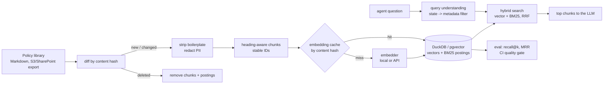

# RAG Ingestion Pipeline: Keeping an LLM's Knowledge Base Correct

[](https://github.com/Kolli-Jahnavi-07/rag-ingestion-pipeline/actions/workflows/ci.yml)

**Stack:** Python · Retrieval-Augmented Generation (RAG) · embeddings · vector search · BM25 in SQL · hybrid search (RRF) · DuckDB · pgvector · PII redaction · retrieval evaluation · GitHub Actions

An LLM assistant is only as good as what it retrieves. This is the **data engineering side of RAG**: the pipeline that turns a changing document library into a search index an assistant can trust. It's built for a loan-servicing support assistant whose policy library differs by state and changes every week.

What it does on every sync:

1. **Diffs the library against the index** by content hash: new, changed, deleted, unchanged, and duplicate documents.
2. **Cleans** each changed document: boilerplate that appears in most documents (footers, disclaimers) is detected and removed, and **PII is redacted** before anything is embedded.
3. **Chunks by heading**, with sentence-aware windows, overlap, and a contextual header ("Late Payments in Ohio > Late charge") so a chunk still says what it's about on its own.
4. **Embeds only what's new**: vectors are cached by chunk content hash, so unchanged chunks of a changed document are never re-embedded.
5. **Writes vectors and a BM25 inverted index** to the same store, and removes every chunk of deleted or changed documents, so retired policy can't be retrieved.
6. **Measures retrieval quality** against 167 graded questions and **fails CI** if recall@5 drops below 97%.



## Results

`make demo` indexes version 1 of the library, evaluates it, then syncs version 2 (5 policies changed, 2 programs retired, 2 launched, 1 FAQ uploaded twice):

```
Version 1 of the knowledge base
  docs: 61 new, 0 changed, 0 deleted, 0 unchanged, 0 duplicate
  chunks written: 144; embeddings computed: 144, reused from cache: 0 (0% saved); PII redactions: 1

Re-sync with nothing changed
  docs: 0 new, 0 changed, 0 deleted, 61 unchanged, 0 duplicate
  chunks written: 0; embeddings computed: 0

Version 2: 5 policies changed, 2 programs retired, 2 lease programs launched, 1 FAQ uploaded twice
  docs: 3 new, 5 changed, 2 deleted, 54 unchanged, 1 duplicate
  chunks written: 24; embeddings computed: 14, reused from cache: 10 (42% saved)

Retrieval quality after the update (167 questions, answers reflect the new policy values):
mode             recall@1  recall@5   MRR@10
vector              55.7%     68.9%    0.620
bm25                51.5%     63.5%    0.576
hybrid              54.5%     71.3%    0.620
hybrid+filter       89.2%    100.0%    0.937
chunks left from retired programs: 0
```

**What the numbers show.** The library is 58 near-identical policy documents (the same templates for 12 states, different numbers), and half the questions are typed the way agents actually type: "max late fee for an OH acct?", "NC payoff letter expires after how long?". Pure vector and pure keyword search both land on the right *topic* in the wrong *state* about a third of the time. Detecting the state in the question and applying it as a **metadata filter** before ranking is what takes recall@5 from 71% to 100%. A question counts as answered only if the retrieved chunk is from the right document *and* contains the current value, so a stale chunk after a policy change counts as a miss.

## Design notes

- **Stable chunk IDs** (hash of document, heading trail and text) make re-processing idempotent and let unchanged chunks keep their vectors.
- **The embedding cache is keyed by content, not by document**, so duplicates and unchanged sections cost nothing to re-embed. With a paid API embedder this is the main cost lever. Unused vectors are pruned after each sync.
- **Duplicates are tracked, not indexed twice.** Indexing the same text twice would crowd the top-k with copies.
- **BM25 runs in SQL** over a postings table (`term, chunk_id, tf`), so keyword and vector search share one store and one transaction. A test checks the SQL scores against a reference implementation.
- **Reciprocal rank fusion** combines vector and keyword rankings without having to calibrate their scores against each other.
- **PII is redacted before embedding.** Once sensitive text is inside a vector index it's very hard to find and remove.
- **Embedders are pluggable.** `HashingEmbedder` (word and character n-grams, deterministic, no downloads) keeps CI offline and reproducible. `OpenAICompatibleEmbedder` calls any OpenAI-compatible endpoint (OpenAI, Azure OpenAI, a self-hosted model) with batching and retries. The hashing embedder captures word overlap, not meaning, so a learned model should lift the vector-only row. The evaluation harness is there to prove it before switching.
- **Production store:** `sql/pgvector_schema.sql` has the same layout on Postgres + pgvector (HNSW index, full-text search for the keyword side, the same filtered query).

## Repository layout

```
src/ragpipe/
  corpus.py       synthetic policy library (2 versions) and 167 graded questions
  text.py         Markdown sections, boilerplate detection, PII redaction, tokenizer
  chunking.py     heading-aware chunks with overlap, contextual headers, stable IDs
  embeddings.py   hashing embedder + OpenAI-compatible API embedder
  store.py        DuckDB tables: documents, chunks, embedding cache, BM25 postings, sync log
  pipeline.py     incremental sync
  retrieval.py    vector, BM25 (SQL), hybrid RRF, state detection and filtering
  evaluate.py     recall@1, recall@5, MRR@10 per retrieval mode
sql/pgvector_schema.sql   the same index on Postgres + pgvector
tests/                    19 tests
```

## Run it

```bash
pip install -r requirements.txt
make test     # 19 tests, ~10 s
make demo     # version 1 -> evaluate -> version 2 -> evaluate
make eval     # the CI quality gate

PYTHONPATH=src python -m ragpipe corpus --out data/docs
PYTHONPATH=src python -m ragpipe sync data/docs
PYTHONPATH=src python -m ragpipe ask "TX repo - how much notice do we owe the customer?"
```

All documents and values are fictional.

## Author

**Sai Jahnavi Kolli**, Data Engineer · [saijahnavikolli.com](https://saijahnavikolli.com) · kollijahnavi07@gmail.com
